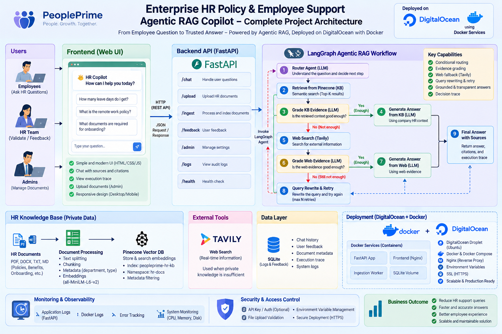

# NexaHR

**NexaHR is an AI-powered employee support copilot for company HR policies and personal employee records.** It combines an evidence-first LangGraph workflow with account-based access to employee profile, leave, attendance, and benefits data.

## Features

- Streamlit workspace for employees and HR administrators.
- Employee self-registration with administrator approval.
- Admin-managed employee accounts, profiles, leave balances, attendance, and benefit records.
- Backend-enforced roles, expiring sessions, password hashing, and forced password changes for admin-created accounts.
- LangGraph policy Q&A using private Pinecone retrieval, evidence grading, Tavily web fallback, and bounded query retries.
- Personal employee questions answered from the signed-in employee's own database records, without sending those records to the RAG model.
- Admin policy document ingestion and visible answer sources/workflow trace.

## Architecture



The diagram is a high-level architecture reference. The current implementation uses FastAPI, a modular Streamlit frontend, SQLAlchemy with SQLite locally/PostgreSQL in production, Pinecone, and a SQLite audit log.

### Technology

- **API and authorization:** Python, FastAPI, SQLAlchemy
- **Frontend:** Streamlit
- **Agent orchestration:** LangGraph and LangChain
- **Language models:** Groq by default; OpenAI is supported
- **Policy search:** Pinecone and Hugging Face sentence-transformer embeddings
- **External search:** Tavily
- **Accounts database:** SQLite locally; PostgreSQL on Render
- **Schema migrations:** Alembic

## Local setup

Use Python 3.12. The project uses separate environments locally: `.venv312` for FastAPI and `.venv` for Streamlit.

```powershell
py -3.12 -m venv .venv312
.\.venv312\Scripts\python.exe -m pip install -r requirements-backend.txt

py -3.12 -m venv .venv
.\.venv\Scripts\python.exe -m pip install -r requirements.txt
```

Copy `.env.example` to `.env` and set your model, Pinecone, Tavily, and initial administrator settings. Never commit `.env` or use example credentials outside local development.

Start the backend from the repository root:

```powershell
.\.venv312\Scripts\python.exe .\Start_App.py
```

In another terminal, start Streamlit:

```powershell
.\.venv\Scripts\python.exe -m streamlit run frontend\streamlit_app.py
```

Open the Streamlit URL printed in the terminal. The local API defaults to `http://127.0.0.1:8888`; its health endpoint is `/api/health`, and API documentation is at `/docs`.

The backend runs Alembic migrations on startup. In development, it seeds a sample employee account (`emp1` / `emp1-demo`) with clearly labeled demo data. The demo account is disabled in production.

## Accounts and employee data

- Employees register with their work email and employee ID. New accounts remain pending until an administrator approves them.
- Admins can add accounts, edit employee and leave details, manage attendance/benefit records, and deactivate/reactivate accounts. Deactivation retains history.
- Admin-created accounts sign in with the temporary password set by the admin and must change it before using the workspace.
- Employees can view only their own profile and records. Company-wide policy questions continue through the existing private-knowledge RAG workflow.
- Employees and HR/Admins use the same **Sign in** form. The first Admin is created at backend startup from `BOOTSTRAP_ADMIN_EMAIL` and `BOOTSTRAP_ADMIN_PASSWORD` when the database has no administrator; those credentials are entered in the shared sign-in form. Employee registration cannot grant admin access.
- The current roles are `admin` and `employee`. HR/Managers who need the admin workspace must be provisioned as `admin`; this role can manage all employee records and upload policy documents. Additional Admin accounts are not currently created from the Streamlit UI.
- Admin credentials are configured on the backend, never in Streamlit secrets. Streamlit secrets should contain only frontend settings such as `API_BASE_URL` and `APP_ENV`.

This is a portfolio prototype, not a complete HR information system. Before using real employee data, add organization identity verification, password recovery, operational audit retention, and a security/privacy review for all model and tracing providers.

## Deployment

### FastAPI backend on Render

Deploy the repository root as a **Docker Web Service**. The root Dockerfile builds only the backend and binds Uvicorn to Render's `PORT`. Configure these in the Render service environment:

```text
APP_ENV=production
DATABASE_URL=<Render PostgreSQL connection string>
BOOTSTRAP_ADMIN_EMAIL=<initial administrator email>
BOOTSTRAP_ADMIN_PASSWORD=<strong initial password>
GROQ_API_KEY=<model credential>
PINECONE_API_KEY=<Pinecone credential>
TAVILY_API_KEY=<Tavily credential>
```

Set `GROQ_MODEL`, Pinecone index/namespace, and embedding settings as needed. Set `LANGSMITH_TRACING=true` and its credentials only if tracing is enabled and the data-handling implications are understood. The bootstrap admin is created only when the database has no admin; after the first successful deployment, the bootstrap password can be removed from Render. Keep secrets out of the image and repository.

Render's container filesystem is ephemeral. Use Render PostgreSQL for accounts and employee records; the audit database and uploaded files need a persistent disk or an external storage solution if they must survive restarts.

### Streamlit Community Cloud frontend

Set the Streamlit app's secrets to point at the deployed backend:

```toml
API_BASE_URL = "https://<your-render-service>.onrender.com"
APP_ENV = "production"
```

The Streamlit server sends authenticated API requests to Render over HTTPS; no browser CORS setup is required. Model, database, Pinecone, Tavily, LangSmith, and bootstrap-admin secrets belong on the backend, not in Streamlit secrets.

Optionally set `STREAMLIT_APP_URL` on Render to your Streamlit Community Cloud URL so the backend landing page links to the frontend.

## API overview

| Endpoint | Access | Purpose |
| --- | --- | --- |
| `GET /api/health` | Public | Backend health check |
| `POST /api/auth/register` | Public | Register a pending employee account |
| `POST /api/auth/login` | Public | Create an authenticated session |
| `GET /api/employee/me` | Employee | Read the signed-in employee's own profile and records |
| `/api/admin/registrations` | Admin | Review, approve, or reject registrations |
| `/api/admin/employees` | Admin | List, add, update, deactivate, and reactivate employees |
| `/api/admin/employees/{id}/attendance` | Admin | Manage attendance records |
| `/api/admin/employees/{id}/benefits` | Admin | Manage benefit records |
| `POST /api/chat` and `/api/chat/stream` | Authenticated | Ask policy or personal employee-record questions |
| `POST /api/ingest` | Admin | Upload and index an HR policy document |

For the compiled agent graph and workflow explanation, see [`langgraph_visualization.ipynb`](langgraph_visualization.ipynb).
