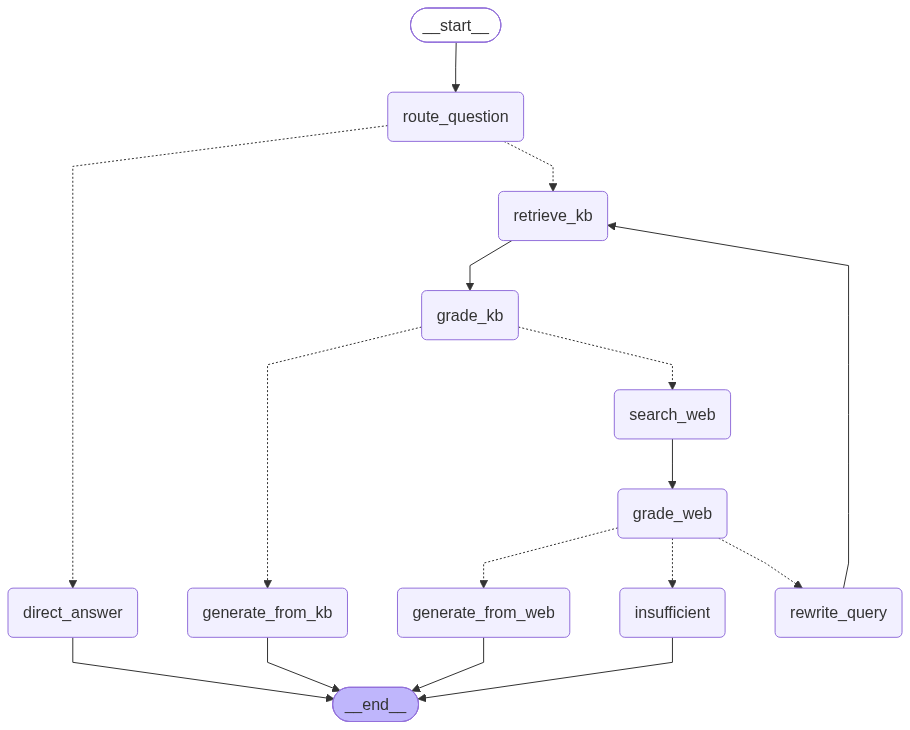

# NexaHR

**NexaHR is an AI-powered employee support copilot that answers workplace and HR policy questions using a company knowledge base, with source-aware responses and a controlled web fallback.**

The project demonstrates an evidence-first, agentic Retrieval-Augmented Generation (RAG) workflow. It is designed to help employees find relevant guidance while making the answer's source and workflow decisions visible.

## Features

- Ask questions about HR policies and workplace support in a Streamlit chat interface.
- Route requests with LangGraph and retrieve relevant company documents from Pinecone.
- Grade retrieved evidence before generating a policy-grounded answer.
- Fall back to Tavily web search when private evidence is insufficient; rewrite and retry weak queries within a configured limit.
- Display workflow progress, final source, and available citations.
- Provide admin document ingestion for PDF, DOCX, TXT, and Markdown files.
- Include a frontend-only employee leave-balance demo to illustrate personalized answers.

## Architecture


The diagram is a high-level target architecture. The current repository implementation uses FastAPI, a modular Streamlit frontend, Pinecone, and a SQLite audit store. Some deployment and UI components shown in the diagram represent design direction rather than a configured production deployment.

## LangGraph Nodes Diagram 


### Technology

- **API:** Python, FastAPI, Uvicorn
- **Frontend:** Streamlit
- **Agent orchestration and RAG:** LangGraph, LangChain
- **Language models:** Groq by default; OpenAI is supported as an alternative
- **Private vector search:** Pinecone with Hugging Face sentence-transformer embeddings
- **External search:** Tavily
- **Audit data:** SQLite

## Getting started

### Requirements

- Python 3.12
- API credentials for a supported language model and the services used by your workflow

### Install

From the repository root, create and activate a virtual environment, then install dependencies:

```powershell
py -3.12 -m venv .venv
.\.venv\Scripts\Activate.ps1
python -m pip install --upgrade pip
python -m pip install -r requirements.txt
```

Create a `.env` file in the project root and configure the services you intend to use:

```env
GROQ_API_KEY=your-groq-api-key
GROQ_MODEL=openai/gpt-oss-120b

PINECONE_API_KEY=your-pinecone-api-key
PINECONE_INDEX_NAME=NexaHR_Policy-RAG
PINECONE_NAMESPACE=company-hr-kb
TAVILY_API_KEY=your-tavily-api-key

# Optional language model alternative
OPENAI_API_KEY=
OPENAI_MODEL=gpt-4o-mini

# Streamlit sign-in and backend connection
NEXAHR_ADMIN_USERNAME=admin
NEXAHR_ADMIN_PASSWORD=replace-with-a-strong-password
NEXAHR_EMPLOYEE_USERNAME=employee
NEXAHR_EMPLOYEE_PASSWORD=replace-with-a-strong-password
ADMIN_API_KEY=replace-with-a-strong-api-key
API_BASE_URL=http://127.0.0.1:8888
```

Keep `.env` private and never commit real credentials. The model defaults to `openai/gpt-oss-120b` when using Groq. An OpenAI key can be used instead when Groq is not configured.

### Run locally

Start the backend from the repository root:

```powershell
python Start_App.py
```

In a second terminal, activate the same virtual environment and start Streamlit:

```powershell
.\.venv\Scripts\Activate.ps1
python -m streamlit run frontend\streamlit_app.py
```

Open the Streamlit URL printed in the terminal. The API is available at `http://127.0.0.1:8888`; interactive API documentation is at `http://127.0.0.1:8888/docs`.

## Agent workflow

For HR questions, the LangGraph workflow routes the request to private knowledge retrieval, grades the retrieved evidence, then answers from the knowledge base when it is sufficient. If evidence is weak, it searches the web and grades those results. A bounded rewrite-and-retry path prevents unsupported answers when neither source provides adequate evidence. Greetings and simple conversational messages can be answered directly without retrieval.

The [`langgraph_visualization.ipynb`](langgraph_visualization.ipynb) notebook renders the compiled backend graph and explains its state, routing, and evidence checks. Live queries are optional and disabled by default.

## API

| Endpoint | Purpose |
| --- | --- |
| `GET /api/health` | Check backend health |
| `POST /api/chat` | Submit a question and receive a complete answer |
| `POST /api/chat/stream` | Stream workflow progress and the final answer |
| `POST /api/ingest` | Upload and index a supported HR document |
| `GET /api/groq-models` | Check Groq model availability for the configured key |

## Demo data and security

The employee leave-balance example uses a local sample record (`emp1`, Alex Morgan) and is for demonstration only. Its data is not authoritative HR data and is not retrieved from the backend knowledge base.

Streamlit's configured usernames and passwords provide basic prototype sign-in, not production identity management. The FastAPI chat endpoints do not currently enforce employee/admin sessions or role-based authorization; the ingestion endpoint uses an admin API key. Do not expose this application or real employee data to a network without adding appropriate authentication, authorization, transport security, and operational controls.
